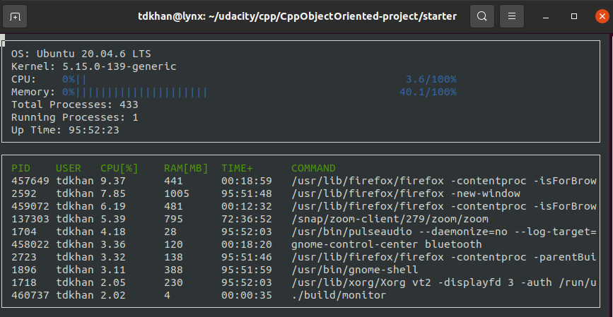

# CppND-System-Monitor

A Linux system monitor written in C++17 for the Object Oriented Programming course of the Udacity C++ Nanodegree. It reads data directly from `/proc` and `/etc` and renders it in the terminal with [ncurses](https://www.gnu.org/software/ncurses/), similar to a minimal `htop`.



## What it shows

**System panel**

- Operating system and kernel version
- Aggregate CPU utilization and memory utilization (progress bars)
- Total and running process counts
- System uptime (`HH:MM:SS`)

**Process panel** (top 10 processes, sorted by CPU, refreshed every second)

- PID, user, CPU %, RAM in MB, process age, and command line

## Build and run

Requirements: Linux, a C++17 compiler, CMake, Make, and ncurses.

```bash
sudo apt install libncurses5-dev libncursesw5-dev   # if ncurses is not installed
cd starter
make build
./build/monitor
```

Make targets: `build`, `debug` (adds debug symbols), `format` (runs ClangFormat), and `clean` (deletes `build/`).

## Project structure

| Class / namespace | Responsibility |
|---|---|
| `LinuxParser` | All reading and parsing of `/proc` and `/etc` files. No state. |
| `System` | Owns the `Processor` and the process list; exposes system-level values. |
| `Processor` | Computes aggregate CPU utilization between two samples. |
| `Process` | Represents one process; takes a CPU snapshot when constructed. |
| `Format` | Converts seconds to `HH:MM:SS`. |
| `NCursesDisplay` | Draws everything (provided by the starter code). |

## How the values are calculated

### System

| Value | Source | Calculation |
|---|---|---|
| OS | `/etc/os-release` | The `PRETTY_NAME` value with surrounding quotes removed. |
| Kernel | `/proc/version` | The third word on the line. |
| Uptime | `/proc/uptime` | First number (seconds), truncated to a whole number. |
| Total processes | `/proc` | Number of numeric directory names, i.e. processes that exist right now. |
| Running processes | `/proc/stat` | The `procs_running` line. |

**Memory utilization** (`/proc/meminfo`):

```
memory = (MemTotal - MemAvailable) / MemTotal
```

`MemAvailable` is used rather than `MemFree` because the kernel counts reclaimable page cache and buffers as available. Using `MemFree` would report memory as nearly full on any machine that has been running for a while. This matches the "used" figure of `free` and `htop` more closely.

**Aggregate CPU utilization** (first `cpu` line of `/proc/stat`). The fields are, in order: `user nice system idle iowait irq softirq steal guest guest_nice`.

```
Idle   = idle + iowait
Total  = user + nice + system + idle + iowait + irq + softirq + steal
Active = Total - Idle

CPU % = ΔActive / (ΔActive + ΔIdle)
```

The Δ values are the difference between two samples. `Processor` stores the previous sample and compares it with the current one on every call, so the bar shows usage over the last refresh interval (about one second), not the average since boot. `guest` and `guest_nice` are left out because the kernel already includes them in `user` and `nice`, so adding them would count that time twice.

### Per process

All per-process data comes from `/proc/<pid>/`.

| Value | Source | Calculation |
|---|---|---|
| CPU % | `stat` | `((utime + stime) / CLK_TCK) / process age`, where `utime` and `stime` are fields 14 and 15 and `CLK_TCK` comes from `sysconf(_SC_CLK_TCK)`. |
| RAM (MB) | `status` | `VmRSS` (in kB) divided by 1024, rounded down. Kernel threads have no `VmRSS` and show `0`. |
| User | `status`, `/etc/passwd` | The first value of the `Uid:` line is looked up in `/etc/passwd` to get the user name. |
| Command | `cmdline` | The file contents with the NUL separators replaced by spaces. |
| Age (TIME+ column) | `stat`, `/proc/uptime` | `system uptime - (starttime / CLK_TCK)`, where `starttime` is field 22. |

Notes on these numbers:

- **Process CPU % is a lifetime average**, not a "right now" value like in `top`. A process that was busy for an hour and is now idle will still show a high number.
- **The TIME+ column shows how long the process has been running** (wall-clock age), as specified by the course, not accumulated CPU time as in `top`.
- The `stat` file is parsed from the *last* `)` onward, because the command name in field 2 can itself contain spaces and parentheses.

## Changes from the starter code

**Implemented**

- Every `LinuxParser` function, plus `System`, `Process`, `Processor`, and `Format::ElapsedTime`.

**Improvements over the original approach**

- `Pids()` uses `std::filesystem::directory_iterator` instead of `opendir`/`readdir` (the course's bonus task).
- `OperatingSystem()` matches the `PRETTY_NAME=` prefix directly instead of replacing characters in the line, so values containing spaces or `=` are parsed correctly.
- CPU time helpers (`Jiffies`, `ActiveJiffies`, `IdleJiffies`) all build on the single `CpuUtilization()` reader, so there is one place that knows the `/proc/stat` layout and they use the `CPUStates` enum instead of magic numbers.
- `System::Processes()` rebuilds the process list on every call, so new processes appear and finished ones disappear, and then sorts it by CPU in descending order. Previously the list was built once at startup and never sorted.
- `Process` calculates its CPU value once, when it is constructed, and `operator<` compares that stored value. This means the sort does not read `/proc` files inside the comparator (which would be slow, and unsafe, because the values could change mid-sort).
- `DisplayProcesses` no longer reads past the end of the process list when fewer than `n` processes exist, and line clearing uses `whline` instead of passing a string of spaces as the `printf` format.
- `Process` accessors are `const`, and member functions that can fail return safe defaults (`0` or an empty string) when a process exits while it is being read.
- Removed unused includes and `using` declarations, and removed the unused `regex` and `fstream` includes from `linux_parser.h`.

## Known limitations

- Linux only (relies on `/proc`).
- Only the top 10 processes are displayed; the count is the `n` argument of `NCursesDisplay::Display`.
- Process CPU % is a lifetime average (see above).